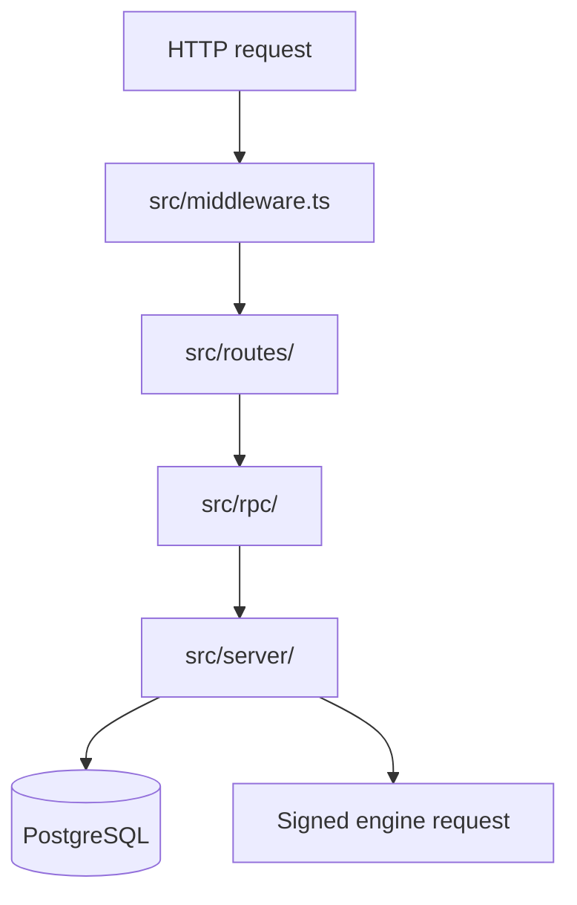

# Web application

The web application serves the Culqi360 UI and HTTP routes, stores CRM state in
PostgreSQL, and runs the maintenance worker. It calls the engine for contact
search, candidate assignment, record imports, and data-source ingestion.

## Request flow



[`src/middleware.ts`](src/middleware.ts) adds request metadata and security
headers, resolves the session, applies the navigation policy, and dispatches the
route. Authenticated routes are under
[`src/routes/(authenticated)/`](src/routes/%28authenticated%29/); public routes
are under [`src/routes/(public)/`](src/routes/%28public%29/); API routes are
under [`src/routes/api/`](src/routes/api/).

RPC modules validate transport input before calling a capability. Server
capabilities and repositories live under [`src/server/`](src/server/). Runtime
assembly is in
[`src/server/composition/application.ts`](src/server/composition/application.ts).

## Persistence and workers

PostgreSQL stores sessions, organizations, workflow state, reporting data,
notifications, and durable jobs. Database access and schema modules live under
[`src/server/platform/database/`](src/server/platform/database/). The
[database guide](docs/database.md) owns initialization, reset, and schema
changes.

The maintenance worker starts at
[`src/workers/maintenance-runner.ts`](src/workers/maintenance-runner.ts). It
uses the shared server runtime, processes durable PostgreSQL jobs, and is woken
by `LISTEN`/`NOTIFY` with polling as recovery. Browser progress and event logs
use the [realtime service](docs/realtime.md).

## Engine integration

The engine client, request signing, response decoding, and ingest contracts are
under [`src/server/integrations/engine/`](src/server/integrations/engine/).
Search is assembled in [`src/server/search/`](src/server/search/), and contact
assignment is under
[`src/server/contact-assignments/`](src/server/contact-assignments/).

## Run the application

From the repository root, after completing the root setup:

```sh
bun run dev:infra:setup
bun run dev
```

`dev:infra:setup` initializes the local PostgreSQL cluster and creates the `crm`
database. `dev` starts PostgreSQL, the engine, the web server, and the
maintenance worker. See [configuration](docs/configuration.md) for required
environment values.

Development uses Vite. A production build is served by the repository's
`apps/web/server.ts` Bun adapter, which calls the generated SolidStart request
handler. Nitro is not part of the current dependency graph or server path.

## Further reading

- [Configuration](docs/configuration.md)
- [Database development](docs/database.md)
- [Cookies](docs/cookies.md)
- [Diagnostics](docs/diagnostics.md)
- [Realtime](docs/realtime.md)
- [End-to-end testing](docs/e2e-testing.md)
- [Merchant statistics](docs/merchant-gpv.md)
- [User terminology](docs/glossary.md)
- [Repository architecture](../../docs/architecture.md)
