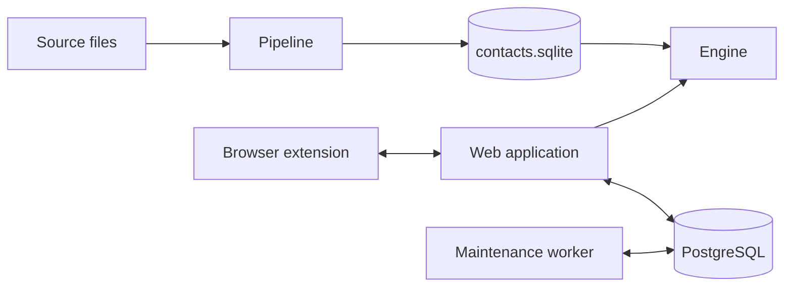

# Architecture

Culqi360 is a web application connected to PostgreSQL, a search and records
engine backed by SQLite, a source-data pipeline, and a browser extension.
PostgreSQL is the system of record for CRM state. The pipeline owns the
published contact dataset. The engine reads that dataset and exposes it to the
web application through signed HTTP requests.

## Web application

The web application serves the UI and API routes. Request middleware builds
request context, resolves the session, applies the navigation policy, and then
dispatches the route. Authenticated routes are under
[`apps/web/src/routes/(authenticated)/`](../apps/web/src/routes/%28authenticated%29/);
public routes are under
[`apps/web/src/routes/(public)/`](../apps/web/src/routes/%28public%29/); API
routes are under [`apps/web/src/routes/api/`](../apps/web/src/routes/api/).

RPC modules in [`apps/web/src/rpc/`](../apps/web/src/rpc/) validate transport
input and call a capability in
[`apps/web/src/server/`](../apps/web/src/server/).
`src/server/composition/application.ts` assembles request-scoped capabilities.
`src/server/platform/database/` owns PostgreSQL access and schema creation.

The maintenance worker starts at
[`maintenance-runner.ts`](../apps/web/src/workers/maintenance-runner.ts). It
uses the shared server runtime without request or framework dependencies. Queue
notifications use PostgreSQL `LISTEN`/`NOTIFY`; the worker also polls so a
missed notification does not leave work pending.

Browser progress and event updates use the server-sent event service under
[`src/server/realtime/`](../apps/web/src/server/realtime/). The browser client
and reconnect policy are under
[`src/browser/realtime/`](../apps/web/src/browser/realtime/). The
[realtime guide](../apps/web/docs/realtime.md) owns that protocol.

## Contact data and engine

The pipeline reads source files described by
[`source-manifest.json`](../crates/pipeline/data/mappings/source-manifest.json),
normalizes rows, merges them into SQLite, materializes engine projections, and
promotes a database only after the quality gate passes. The runtime and command
flow are implemented under [`crates/pipeline/src/`](../crates/pipeline/src/).

The engine opens the promoted contacts database through a read-only pool and
opens its writable leads database separately. It validates both schemas during
startup, then mounts the search and records routers. The runtime assembly is in
[`runtime.rs`](../crates/engine/src/runtime.rs); search is in
[`crates/search/`](../crates/search/); candidate and import workflows are in
[`crates/leads/`](../crates/leads/). Optional upload ingestion is in
[`crates/engine/src/ingest/`](../crates/engine/src/ingest/).

The JSON contracts in [`contracts/engine/`](../contracts/engine/) and
[`contracts/pipeline/`](../contracts/pipeline/) are the source of truth for
generated projection and API types. Run `bun run check:contracts` and
`bun run check:search-contract` when changing a contract boundary.

## Browser extension

The extension service worker starts at
[`entrypoints/background.ts`](../apps/extension/entrypoints/background.ts) and
registers [`runtime.ts`](../apps/extension/src/background/runtime.ts). It
persists call state, stores large recording payloads separately, queues sync
jobs, and sends those jobs to the web application.

The web application creates the signed handoff and session endpoints under
[`apps/web/src/routes/api/extension/`](../apps/web/src/routes/api/extension/).
The extension verifies the handoff in
[`external-auth.ts`](../apps/extension/src/services/external-auth.ts) before it
claims a session.
