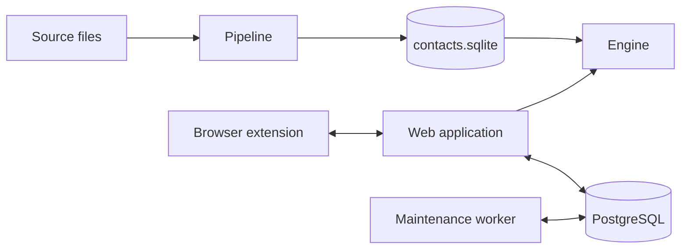
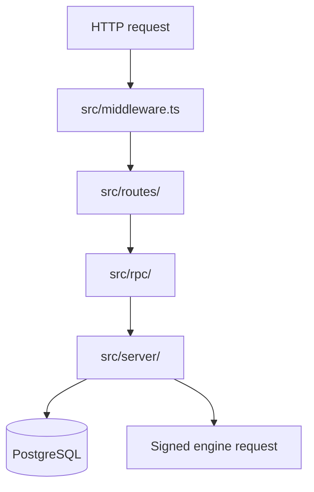

# Architecture

Culqi360 is a web application connected to PostgreSQL, a search and records
engine backed by SQLite, a source-data pipeline and a browser extension.
PostgreSQL is the system of record for CRM state. The pipeline owns the
published contact dataset. The engine reads that dataset and exposes it to the
web application through signed HTTP requests.

## Web application

A request passes through these layers:

[`middleware.ts`](../apps/web/src/middleware.ts) adds request metadata and
security headers, resolves the session, applies the navigation policy and
dispatches the route. Authenticated routes are under
[`routes/(authenticated)/`](../apps/web/src/routes/%28authenticated%29/), public
routes under [`routes/(public)/`](../apps/web/src/routes/%28public%29/), login
and password-reset routes under
[`routes/(auth)/`](../apps/web/src/routes/%28auth%29/), and API routes under
[`routes/api/`](../apps/web/src/routes/api/).

RPC modules in [`rpc/`](../apps/web/src/rpc/) validate transport input and call
a capability in [`server/`](../apps/web/src/server/). Capabilities and
repositories live there.
[`server/composition/application.ts`](../apps/web/src/server/composition/application.ts)
assembles them. Actions run through the [action runtime](action-runtime.md).

PostgreSQL stores sessions, organizations, workflow state, reporting data,
notifications and durable jobs.
[`server/platform/database/`](../apps/web/src/server/platform/database/) holds
the access code and the schema. [Database development](database.md) covers
initialization, reset and schema changes.

The maintenance worker starts at
[`maintenance-runner.ts`](../apps/web/src/workers/maintenance-runner.ts). It
uses the shared server runtime without request or framework dependencies and
processes durable jobs from PostgreSQL. Queue notifications use `LISTEN` and
`NOTIFY`, and the worker also polls so a missed notification does not leave work
pending.

Browser progress and event updates use the server-sent event service in
[`server/realtime/`](../apps/web/src/server/realtime/). The browser client and
reconnect policy are in
[`browser/realtime/`](../apps/web/src/browser/realtime/).
[Realtime](realtime.md) describes the protocol.

Each operation reads the clock once, at the edge where it enters the system. The
edges are an HTTP request ([`middleware.ts`](../apps/web/src/middleware.ts)), a
claimed job batch
([`job-queue.ts`](../apps/web/src/server/platform/jobs/job-queue.ts)) and a
scheduled tick
([`maintenance-worker.ts`](../apps/web/src/server/entrypoints/worker/maintenance-worker.ts)).
That instant is `operationAt` on the context the layer already passes, and
everything the operation writes uses it. Events outside the inbound operation,
such as job settlement, a lease heartbeat or an engine response, read the clock
at the event boundary. A `clock-boundary` comment marks each read whose instant
is recorded. A function takes a bare `Date` only to compare, calculate or store
it, and names it for that use (`activeAsOf`, `expiresBefore`). Durations use
`performance.now()`, because a wall-clock adjustment can make a subtraction
negative.

The engine client, request signing, response decoding and ingest contracts are
in [`server/integrations/engine/`](../apps/web/src/server/integrations/engine/).
Search is assembled in [`server/search/`](../apps/web/src/server/search/) and
contact assignment is in
[`server/contact-assignments/`](../apps/web/src/server/contact-assignments/).

## Contact data and engine

The pipeline reads the source files listed in
[`source-manifest.json`](../crates/pipeline/data/mappings/source-manifest.json),
normalizes rows, merges them into SQLite, materializes the engine projections
and promotes a database only after the quality gate passes. The code is in
[`crates/pipeline/src/`](../crates/pipeline/src/).

The engine opens the promoted contacts database through a read-only pool and
opens its writable leads database separately. It validates both schemas at
startup, then mounts the search and records routers.
[`runtime.rs`](../crates/engine/src/runtime.rs) assembles them. Search is in
[`crates/search/`](../crates/search/), candidate and import workflows are in
[`crates/leads/`](../crates/leads/), and the optional upload ingestion is in
[`crates/engine/src/ingest/`](../crates/engine/src/ingest/).

The [engine readme](../crates/engine/readme.md#code-map) maps the crates. The
[contracts guide](contracts.md) owns the JSON contracts and their generated
files.

## Browser extension

The service worker starts at
[`entrypoints/background.ts`](../apps/extension/entrypoints/background.ts) and
registers [`runtime.ts`](../apps/extension/src/background/runtime.ts). It
persists call state, stores large recording payloads separately, queues sync
jobs and sends them to the web application.

The web application creates the signed handoff and session endpoints in
[`routes/api/extension/`](../apps/web/src/routes/api/extension/). The extension
verifies the handoff in
[`external-auth.ts`](../apps/extension/src/services/external-auth.ts) before it
claims a session.

## Deployment

The application and the engine deploy as two Compose stacks. The
[deployment guide](deployment.md) describes them.

## Shared packages and tools

TypeScript packages under [`packages/`](../packages/) are Bun workspace members
that the applications import:

- [`contracts`](../packages/contracts/): extension bridge types.
- `email-composer`: email templates. `bun run generate:templates` compiles them
  into `src/templates/compiled/`, which git ignores.
- `fetch-refs`: `bun run refs:fetch` downloads third-party reference
  documentation (OWASP, SolidJS, Twenty) for local reading.
- `images`: the responsive image component and its Vite plugin.
- `message-channels`: the email and WhatsApp delivery providers.

[`tools/codegen/`](../tools/codegen/) generates the contract artifacts.
[`tools/data-conversion/`](../tools/data-conversion/) holds scripts that convert
and merge source files, generate sample import responses from an export, and
compare pipeline runs. [`tools/review/churn.ts`](../tools/review/churn.ts) ranks
the files a branch changed by how much of each changed.
