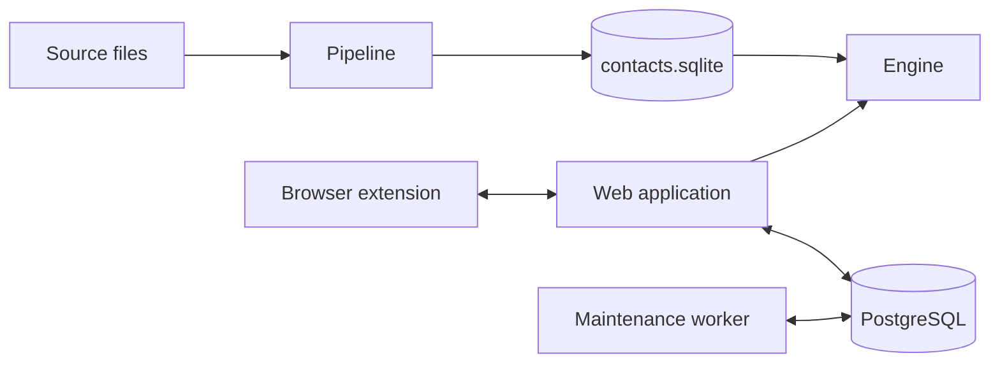
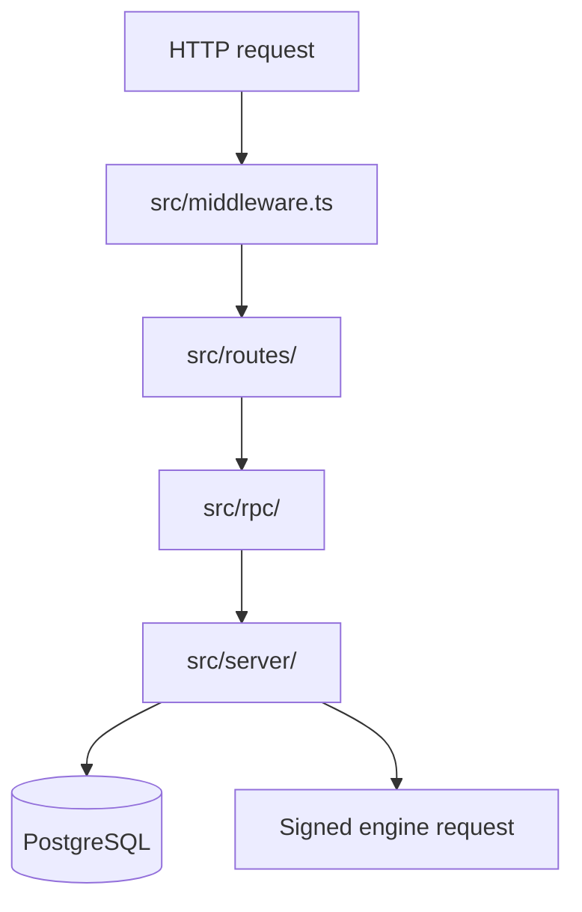

# Architecture

Culqi360 is a web application connected to PostgreSQL, a search and records
engine backed by SQLite, a source-data pipeline and a browser extension.
PostgreSQL is the system of record for CRM state. The pipeline owns the
published contact dataset. The engine reads that dataset and exposes it to the
web application through signed HTTP requests.

## Web application

A request passes through these layers:

[`middleware.ts`](../apps/web/src/middleware.ts) adds request metadata and
security headers, resolves the session, applies the navigation policy and
dispatches the route. Authenticated routes are under
[`routes/(authenticated)/`](../apps/web/src/routes/%28authenticated%29/), public
routes under [`routes/(public)/`](../apps/web/src/routes/%28public%29/), login
and password-reset routes under
[`routes/(auth)/`](../apps/web/src/routes/%28auth%29/), and API routes under
[`routes/api/`](../apps/web/src/routes/api/).

RPC modules in [`rpc/`](../apps/web/src/rpc/) validate transport input and call
a capability in [`server/`](../apps/web/src/server/). Capabilities and
repositories live there.
[`server/composition/application.ts`](../apps/web/src/server/composition/application.ts)
assembles them. Actions run through the [action runtime](action-runtime.md).

PostgreSQL stores sessions, organizations, workflow state, reporting data,
notifications and durable jobs.
[`server/platform/database/`](../apps/web/src/server/platform/database/) holds
the access code and the schema. [Database development](database.md) covers
initialization, reset and schema changes.

The maintenance worker starts at
[`maintenance-runner.ts`](../apps/web/src/workers/maintenance-runner.ts). It
uses the shared server runtime without request or framework dependencies and
processes durable jobs from PostgreSQL. Queue notifications use `LISTEN` and
`NOTIFY`, and the worker also polls so a missed notification does not leave work
pending.

Browser progress and event updates use the server-sent event service in
[`server/realtime/`](../apps/web/src/server/realtime/). The browser client and
reconnect policy are in
[`browser/realtime/`](../apps/web/src/browser/realtime/).
[Realtime](realtime.md) describes the protocol.

Each operation reads the clock once, at the edge where it enters the system. The
edges are an HTTP request ([`middleware.ts`](../apps/web/src/middleware.ts)), a
claimed job batch
([`job-queue.ts`](../apps/web/src/server/platform/jobs/job-queue.ts)) and a
scheduled tick
([`maintenance-worker.ts`](../apps/web/src/server/entrypoints/worker/maintenance-worker.ts)).
That instant is `operationAt` on the context the layer already passes, and
everything the operation writes uses it. Events outside the inbound operation,
such as job settlement, a lease heartbeat or an engine response, read the clock
at the event boundary. A `clock-boundary` comment marks each read whose instant
is recorded. A function takes a bare `Date` only to compare, calculate or store
it, and names it for that use (`activeAsOf`, `expiresBefore`). Durations use
`performance.now()`, because a wall-clock adjustment can make a subtraction
negative.

The engine client, request signing, response decoding and ingest contracts are
in [`server/integrations/engine/`](../apps/web/src/server/integrations/engine/).
Search is assembled in [`server/search/`](../apps/web/src/server/search/) and
contact assignment is in
[`server/contact-assignments/`](../apps/web/src/server/contact-assignments/).

## Contact data and engine

The pipeline reads the source files listed in
[`source-manifest.json`](../crates/pipeline/data/mappings/source-manifest.json),
normalizes rows, merges them into SQLite, materializes the engine projections
and promotes a database only after the quality gate passes. The code is in
[`crates/pipeline/src/`](../crates/pipeline/src/).

The engine opens the promoted contacts database through a read-only pool and
opens its writable leads database separately. It validates both schemas at
startup, then mounts the search and records routers.
[`runtime.rs`](../crates/engine/src/runtime.rs) assembles them. Search is in
[`crates/search/`](../crates/search/), candidate and import workflows are in
[`crates/leads/`](../crates/leads/), and the optional upload ingestion is in
[`crates/engine/src/ingest/`](../crates/engine/src/ingest/).

The [engine readme](../crates/engine/readme.md#code-map) maps the crates. The
[contracts guide](contracts.md) owns the JSON contracts and their generated
files.

## Browser extension

The service worker starts at
[`entrypoints/background.ts`](../apps/extension/entrypoints/background.ts) and
registers [`runtime.ts`](../apps/extension/src/background/runtime.ts). On every
wake (a browser start, an install or update, or an idle restart) it migrates a
stored v1 install, closes the recordings whose recorder is gone, ensures the
sync alarm exists, then handles messages and sends the queue. The offscreen
document
([`entrypoints/offscreen/main.ts`](../apps/extension/entrypoints/offscreen/main.ts))
records the call tab. These two contexts are the only writers of the database.

The web application creates the signed handoff and session endpoints in
[`routes/api/extension/`](../apps/web/src/routes/api/extension/). The extension
sends the handoff token to the claim endpoint as it is, and the server verifies
the signature and the single use.

### Extension storage

[`database.ts`](../apps/extension/src/services/database.ts) opens one IndexedDB
database, `crm_extension`, that holds all durable state:

| Store        | Rows                                                                  |
| ------------ | --------------------------------------------------------------------- |
| `calls`      | One row per call, keyed by the server's `callId`.                     |
| `recordings` | One row per recording: local id, server id, status and call.          |
| `chunks`     | Append-only audio, keyed by `[recordingId, seq]`, one row per second. |
| `queue`      | Sync jobs in sequence order, with attempts, last error and `deadAt`.  |
| `meta`       | The sequence counter and the last sync result.                        |

`commit(fn)` runs `fn` in one readwrite transaction, and commits run one at a
time. A function handed to `commit` or `read` may await only the transaction's
own operations, because any other await lets IndexedDB close the transaction. A
state change and the jobs it queues are written in the same commit. A commit
that changes a row reads it again inside the transaction, never from an earlier
snapshot, because the other context may have changed it meanwhile.

`browser.storage.local` keeps only the installation session (the installation id
and the tokens). The session is signed in while it holds tokens. A refused
refresh clears the tokens and signs the agent out, and the next handoff claim
signs in again. [`migration.ts`](../apps/extension/src/services/migration.ts)
imports a v1 queue the first time the worker starts, keeping each job's id,
sequence, attempts and payload, and deletes the v1 data.

### Extension states

Each state has one owner. A transition not listed is refused.

| Entity    | State       | Entered by                                        | Next states           |
| --------- | ----------- | ------------------------------------------------- | --------------------- |
| call      | `ready`     | worker, when a web handoff is claimed             | `dialing`             |
| call      | `dialing`   | worker, `call.start`                              | `active`, `ended`     |
| call      | `active`    | worker, `call.connected`                          | `ended`               |
| call      | `ended`     | worker, `call.end`; it also stops the recorder    | none                  |
| recording | `recording` | offscreen, `beginRecording`                       | `closing`             |
| recording | `closing`   | offscreen, `finishRecording`; it queues the close | `complete`, `closing` |
| recording | `complete`  | worker, when the server answers `complete`        | none                  |

- A claim is refused while a call is `dialing` or `active`. A second claim of
  the same call changes nothing.
- A call has at most one recording, and recording starts only while the call is
  `dialing` or `active`. The transaction that creates the recording row checks
  this, because the call can end while the capture stream is being set up.
- `closing` returns to `closing` when the server answers `missing`: the segments
  are queued again and the close is retried.
- A recording's `remoteId` is empty until the create job succeeds, which only
  the worker does. `finishRecording` sets `interrupted` when the media stream
  ends by itself (for example when the tab closes) or a chunk cannot be written.
  It acts only on a `recording` row.
- The offscreen document adds a chunk row once per second, together with its
  segment job. Only the worker deletes chunk rows, and only in the commit that
  makes the recording `complete`.
- A `recording` row whose recorder died is closed by the worker as `interrupted`
  (see liveness below). That is the only way the worker moves a recording out of
  `recording`.

Queue jobs:

| Job                 | Queued by                                     | Removed when                                | Waits for                              |
| ------------------- | --------------------------------------------- | ------------------------------------------- | -------------------------------------- |
| `event`             | worker, in the commit of its change           | the server answers 2xx                      | nothing                                |
| `recording.create`  | offscreen, `beginRecording`                   | `remoteId` is stored                        | nothing                                |
| `recording.segment` | offscreen, `storeChunk`; worker, on `missing` | the server answers 2xx or the chunk is gone | `remoteId`                             |
| `recording.close`   | offscreen, `finishRecording`                  | the recording is `complete`                 | `remoteId` and every segment job of it |

Only the worker sends jobs, and one pass runs at a time. A job that waits for
another counts no attempt. Events and each recording are separate lanes, so a
failing upload does not delay call events. A 401 refreshes the session once, and
a 401 on the retried send counts as a failed attempt.

How a failure ends:

| Failure                                 | Result                                             |
| --------------------------------------- | -------------------------------------------------- |
| 408, 425, 429, any 5xx, a network error | `attempts + 1`, retried after a backoff            |
| any other 4xx (except 401)              | parked at once as a dead letter                    |
| the 20th failed attempt of one job      | parked as a dead letter                            |
| a refused session refresh               | the agent is signed out, and no attempt is counted |

The backoff ceiling is `2^n` seconds (at most five minutes), and the delay is a
random point between half the ceiling and all of it, so extensions that saw the
same outage do not retry together. A failure holds the rest of its lane for the
pass, which costs one attempt per lane instead of one per job.

A dead letter keeps its row, its payload and its last error, and no pass sends
it again, not even `sync.flush`. It does not block its lane, but a recording's
close still waits for the dead segments of that recording, and a dead create
keeps its segments waiting. The state reports `queue.dead`, the dashboard shows
the count with a "Retry failed jobs" button, and `queue.retryDead` puts every
dead letter back on the schedule with a fresh attempt count. A dead heartbeat is
deleted instead, because the next alarm queues a fresh one.

### Extension recording and upload

The offscreen document records the agent's microphone and the tab together. One
`AudioContext`
([`channel-mix.ts`](../apps/extension/src/services/channel-mix.ts)) merges the
microphone into the left channel and the tab into the right, and `MediaRecorder`
encodes that two-channel stream as Opus in 1 s chunks. Each chunk row and its
upload carry the layout `mic-left,tab-right` (the `x-channels` header). The tab
source is also connected to the context's `destination`, because capturing a tab
mutes the tab's own output for the agent and the routed copy plays it again.

An offscreen document cannot ask for the microphone. The side panel shows
`microphone not allowed` with a button that opens
[`permission.html`](../apps/extension/entrypoints/permission/index.html), a
visible extension page that asks once. After the extension origin holds the
grant the offscreen document opens the microphone with no page. Without the
grant the recorder fails with exactly `microphone not allowed`, and the tab
stream is released, so a retry is not blocked by an unused stream id.

If the microphone track ends mid-call, the recording goes on with the tab only
and a silent left channel. The offscreen document is the only writer of
`microphoneLostAt`. Its `ended` listener calls `recordMicrophoneLost`, which in
one IndexedDB transaction sets the field on the recording row and queues a
`call.metric` event with `event: "microphone_lost"`. The field moves once, from
null to a timestamp, and only while the row is `recording`, so a second `ended`
event, or one after the close was queued, changes nothing. The worker and the
side panel only read it: the worker copies it into the state as
`recording.microphoneLost`, and the panel shows the notice on its next poll.
Stopping the tracks at the end of a recording or after a failed start is not a
loss: the document marks the capture released first, and its listeners ignore
any `ended` that follows. If the tab track ends while recording, the recording
closes as interrupted.

Chrome lets an extension capture a tab only after an activeTab invocation on
that tab: a click on the extension icon, or the `start-recording` shortcut
(`Alt+Shift+K` by default, declared as a manifest `commands` entry). While a
call is live and nothing records it, the toolbar badge shows `!` and the
dashboard says "Click the extension icon on the call tab to resume recording",
with a "Record this tab" button that records the tab that is active when it is
clicked. The worker creates the offscreen document before it asks for the stream
id, and the document opens that single-use id at once. A start is tried once. If
Chrome refuses it (a tab with an active stream stays blocked for about a
minute), the reason is stored and shown on the dashboard until the next start,
and nothing retries by itself. A recording that was interrupted cannot be
started again, because the server accepts one recording per call.

Liveness is a Web Lock, not a heartbeat. The offscreen document takes
`recording:{callId}` before it writes the recording row and releases it after
the close is queued, so a `recording` row always has a holder. Chrome releases a
lock when its holder dies, whether the document crashed or the browser quit. The
worker, on every wake and every alarm, asks for the lock of each `recording` row
with `ifAvailable`. A lock it gets means nobody records, so it queues the close
with `interrupted: true`, even when no chunk was stored (the close then reports
zero segments, as for any silent recording). A second recorder for the same call
cannot get the lock and is refused.

The extension requests `unlimitedStorage`, which lifts the quota, and the
offscreen document calls `navigator.storage.persist()` before the first chunk,
which asks the browser not to evict the database. Only a window can ask, so a
service worker cannot. A refusal is logged and the recording goes on.

Each chunk goes into IndexedDB with its job in one transaction, and only then
does the document tell the worker the chunk key, so no audio crosses a message
hop before it is on disk. A chunk sequence number is taken only after its write
succeeds, so stored sequence numbers are 0..n-1 without gaps. After a failed
write no later chunk is stored and the recording closes as interrupted.

[`deliver.ts`](../apps/extension/src/services/deliver.ts) sends the jobs to the
receiver contract below: `POST` creates the recording and returns the server's
`recordingId`, each chunk is a `PUT` of its bytes to `.../segments/{seq}`, and
the close sends the manifest (segment count, total bytes, `interrupted`) after
the last segment. A 2xx on a segment never deletes local audio. Only a close
that the server answers `complete`, for the same count and bytes, does, and the
commit that deletes it first checks the stored chunks still match them. A
recording stopped before its first chunk closes with zero segments, because its
create job may already have reached the server.

### Call recordings

The extension uploads a call as 1 s audio segments. The server mints every id:
`claim` returns the `callId`, and `POST /api/extension/recordings` returns the
`recordingId`. A recording belongs to the user and installation that claimed its
call, not to the session, so a re-login does not strand audio the extension
still holds. Another user's or installation's ids answer 404. The routes are in
[`routes/api/extension/recordings/`](../apps/web/src/routes/api/extension/recordings/),
the lifecycle in
[`service/recordings.ts`](../apps/web/src/server/extension/service/recordings.ts)
and the wire contract in
[`packages/contracts/src/extension.ts`](../packages/contracts/src/extension.ts).

A recording has one status, and three actors move it:

| Status        | Set by                                          | Segment `PUT`          | Close                                                   |
| ------------- | ----------------------------------------------- | ---------------------- | ------------------------------------------------------- |
| `open`        | recording creation                              | stored                 | `complete`, or `missing: [...]` and stays `open`        |
| `interrupted` | sweeper, after 10 minutes with no segment       | stored                 | `complete`, or `missing: [...]` and stays `interrupted` |
| `complete`    | extension close with segments 0..n-1 all stored | 409 `recording_closed` | same manifest answers `complete`, another is 409        |

- The extension's segment `PUT` never changes the status. Its close is the only
  way to `complete`, and the server answers `complete` only when segments 0..n-1
  are stored and add up to the manifest's bytes. That answer is the only one
  that lets the extension delete its local audio.
- A complete close overwrites `interrupted`. `complete` is final.
- The sweeper moves only `open` recordings to `interrupted`. It never touches an
  `interrupted` or a `complete` one, so a sweep cannot overwrite a close.
- A segment, a close and the sweeper's status change are serialized per
  recording (a row lock, and a status condition on the sweep), so no segment is
  stored after `complete`.
- Only a stored segment or an identical repeat of one refreshes the recording's
  last activity. A conflicting upload (409) and a close that reports missing
  segments do not, so a client that keeps retrying cannot hold a recording open.
- A call ends at the first of: a complete close, the sweep of its recording, or
  the sweeper finding no recording for the call 10 minutes after the claim.
- A segment is idempotent per `(recording, seq)`: the same bytes answer 200 with
  the stored size, other bytes answer 409. The blob is written first under a key
  that carries the content hash, then the row. A failed insert deletes the blob
  unless a row references it. A crash between the two leaves an unreferenced
  blob, never a row that points at a missing one.
- The route checks `Content-Length` against the segment limit, then the service
  authenticates the session and checks the recording, and only then reads the
  body.

## Deployment

The application and the engine deploy as two Compose stacks. The
[deployment guide](deployment.md) describes them.

## Shared packages and tools

TypeScript packages under [`packages/`](../packages/) are Bun workspace members
that the applications import:

- [`contracts`](../packages/contracts/): extension bridge types.
- `email-composer`: email templates. `bun run generate:templates` compiles them
  into `src/templates/compiled/`, which git ignores.
- `fetch-refs`: `bun run refs:fetch` downloads third-party reference
  documentation (OWASP, SolidJS, Twenty) for local reading.
- `images`: the responsive image component and its Vite plugin.
- `message-channels`: the email and WhatsApp delivery providers.
- [`tsconfig`](../packages/tsconfig/readme.md): the base TypeScript
  configurations that every package and tool extends.

[`tools/codegen/`](../tools/codegen/) generates the contract artifacts.
[`tools/data-conversion/`](../tools/data-conversion/) holds scripts that convert
and merge source files, generate sample import responses from an export, and
compare pipeline runs. [`tools/review/churn.ts`](../tools/review/churn.ts) ranks
the files a branch changed by how much of each changed.
