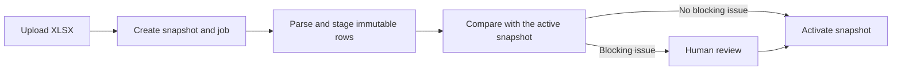

# Merchant statistics

Merchant statistics imports complete Culqi report snapshots and shows GPV by
merchant RUC, realized month, and CRM executive. Users see the term GPV. The
code is the `merchant-stats` capability, which owns imports, validation,
attribution, targets, and read models.

`m0` is the GPV realized during the sale month, `m1` the next calendar month,
and so on. A target belongs to a RUC and is effective-dated. It is the monthly
GPV the RUC should approach, not a total across an executive's portfolio.

## Snapshot lifecycle

[`uploadMerchantReport`](../apps/web/src/rpc/merchant-stats/imports.ts) stores
the file and creates a queued snapshot. The maintenance worker processes its job
through the merchant-stats runtime. Parsing is in
[`intake/`](../apps/web/src/server/merchant-stats/intake/). Staging, validation,
and activation are in
[`snapshot/`](../apps/web/src/server/merchant-stats/snapshot/).

A snapshot is a complete cut of the report. The validator never rewrites an
earlier cut. It records blocking differences, such as a missing placement, a
changed RUC, or a changed sale month, and a person resolves them before
activation. Warnings, such as a RUC or owner missing from CRM, stay visible and
do not block activation.

One snapshot is active. Activation locks the dataset row, supersedes the
previous active snapshot, and freezes uncredited merchant months against the
snapshot that first made them available.

## Ownership, attribution, and targets

CRM ownership decides which executive a RUC belongs to. Culqi's seller code is
report context, not the internal executive identity. An executive reads a RUC
only while they are its current CRM owner. Managers read the team view.

A snapshot freezes monthly merchant credit when it first exposes the month, so a
later ownership change does not rewrite historical progress. A manager can
record an explicit monthly credit correction with
[`adjustMonthCredit`](../apps/web/src/rpc/merchant-stats/attribution.ts).

Targets are effective-dated per RUC. Updating the same RUC and effective month
replaces that target. Adding a later effective month keeps the earlier periods.

## Access

| Permission            | Access                                                           |
| --------------------- | ---------------------------------------------------------------- |
| `dashboards:read`     | Team dashboards and GPV quality views.                           |
| `dashboards:read:own` | The caller's currently owned RUCs and progress.                  |
| `dashboards:manage`   | Imports, issue resolution, targets, credits, and quality review. |

## Realtime and storage

Import progress travels through PostgreSQL notifications and reaches the import
page as server-sent events ([Realtime](realtime.md)). After a reconnect the
stream reads the durable job row again, so a missed browser event cannot change
job state.

Uploaded workbooks and exported GPV files go through the shared file service. A
snapshot references its file asset, and application code does not build report
paths or manage storage itself.

## Schema and demo data

The tables are defined in
[`merchant-stats.ts`](../apps/web/src/server/platform/database/schema/modules/merchant-stats.ts)
and its types file. They include `gpv_snapshots`, `gpv_snapshot_jobs`,
`gpv_snapshot_placements`, `gpv_snapshot_observations`, `gpv_snapshot_issues`,
`merchant_month_credits`, and `merchant_gpv_targets`.

Demo data is in
[`seeds/demo/merchant-stats/`](../apps/web/src/server/platform/database/seeds/demo/merchant-stats/).
Schema changes follow [Database development](database.md).
